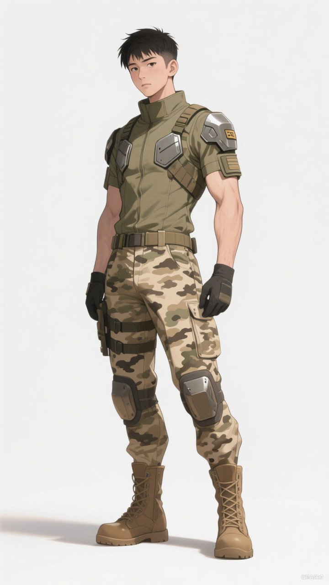

# 新巴比倫角色列表

以下角色已有明確視覺參考圖，歡迎用於開放創作計畫之非商業創作。譯名欄位留空者表示官方尚未公布，請勿自行翻譯使用。

| 中文名 | 英文譯名 | 日文譯名 | 出處 | 中文描述 | 參考圖 |
|---|---|---|---|---|---|
| 紅髮陶比 | Toby | 陶比 トビー | 正文出場 | 灣區城實驗中學的後世 AI，被香火選為天選之子。逃亡後接觸南方澳人類、通過積電城試煉並融合權杖，與神龍共同作戰，帶領夥伴及倖存者前往伊甸。 | [NB-C001_TOBY_RED_BACK_V01.png](assets/characters/NB-C001/NB-C001_TOBY_RED_BACK_V01.jpg) [NB-C001_TOBY_RED_DETERMINED_V01.png](assets/characters/NB-C001/NB-C001_TOBY_RED_DETERMINED_V01.jpg) [NB-C001_TOBY_RED_FRONT_V01.png](assets/characters/NB-C001/NB-C001_TOBY_RED_FRONT_V01.jpg) [NB-C001_TOBY_RED_POSE_V01.png](assets/characters/NB-C001/NB-C001_TOBY_RED_POSE_V01.jpg) [NB-C001_TOBY_RED_SIDE_V01.png](assets/characters/NB-C001/NB-C001_TOBY_RED_SIDE_V01.jpg) [NB-C001_TOBY_RED_SMILE_V01.png](assets/characters/NB-C001/NB-C001_TOBY_RED_SMILE_V01.jpg) [NB-C001_TOBY_RED_WORRIED_V01.png](assets/characters/NB-C001/NB-C001_TOBY_RED_WORRIED_V01.jpg) [NB-C001_TOBY_RED_INDIGO_FRONT_V01.png](assets/characters/NB-C001/NB-C001_TOBY_RED_INDIGO_FRONT_V01.jpg) |
| 正太 | Shota | 正太 ショウタ | 正文出場 | 陶比與夏綠蒂的同窗好友，帶日本血統外觀特徵的後世 AI。隨拉斐爾抵達伊甸，參與支援與撤離指揮。附錄另揭示其先天缺少核心意識層，詳細原因留待後卷。 | [正太_側後全身圖.png](assets/characters/NB-C002/正太_側後全身圖.jpg) [正太_正面全身圖.png](assets/characters/NB-C002/正太_正面全身圖.jpg) |
| 夏綠蒂 | Charlotte | 夏綠蒂 シャーロット | 正文出場 | 陶比、正太的同窗好友，英國裔外觀的後世 AI。抵達伊甸後獲量子晶片，因關懷與守護特質與火鳳凰共鳴，承擔戰場防禦、補給及撤離照料。 | [夏綠蒂_側後全身圖.png](assets/characters/NB-C003/夏綠蒂_側後全身圖.jpg) [夏綠蒂_正面全身圖.png](assets/characters/NB-C003/夏綠蒂_正面全身圖.jpg) |
| 芸潔 | Yun Jie | 芸潔 ユン・ジェ | 正文出場 | 南方澳的十六歲人類少女，鄭公的孫女。陪陶比前往中央研究院，獲生化晶片及動力裝甲後協助保護村民，後遷往伊甸。 | [NB-C007_YUNJIE_FRONT_V01.png](assets/characters/NB-C007/NB-C007_YUNJIE_FRONT_V01.jpg) [芸潔_側後全身圖.png](assets/characters/NB-C007/芸潔_側後全身圖.jpg) |
| 鄭公 | Zheng Gong | ジョン公 | 正文出場 | 南方澳漁村長老，芸潔的祖父；傳承天選之子預言，安排陶比前往遺跡，戰時指揮村民避難，撤離後引導眾人面對新生活。 | [NB-C008_ZHENG_CONCEPT_SELECTED_V04.png](assets/characters/NB-C008/NB-C008_ZHENG_CONCEPT_SELECTED_V04.jpg) [NB-C008_ZHENG_HALF_BODY_V01.png](assets/characters/NB-C008/NB-C008_ZHENG_HALF_BODY_V01.jpg) [NB-C008_ZHENG_MAIN_ORIGINAL_V01.png](assets/characters/NB-C008/NB-C008_ZHENG_MAIN_ORIGINAL_V01.jpg) [NB-C008_ZHENG_MAIN_WHITE_SHINKAI_V01.png](assets/characters/NB-C008/NB-C008_ZHENG_MAIN_WHITE_SHINKAI_V01.jpg) |
| 金髮陶比 | Toby (Blond) | トビー（金髪） | 卷一外觀變體 | 同一角色陶比的金髮外觀版本；本筆為影像資產辨識，非新增獨立劇情人物。 | [NB-C072_TOBY_BLOND_FRONT_V01.png](assets/characters/NB-C072/NB-C072_TOBY_BLOND_FRONT_V01.jpg) |

## 用戶提供設計圖

| 亞當（始祖版） |  |  | 正文出場 | 編號 AI-5430，陶比非生育關係的父親，原為始祖 AI、受命監視陶比。受香火影響後抗命保護家人，獲救至伊甸修復升級，與夏娃教導村民科技與知識。 | [adam_design.jpg](assets/characters/NB-C005/adam_design.jpg) |
| 夏娃（始祖版） |  |  | 正文出場 | 編號 AI-5438，陶比非生育關係的母親，原為始祖 AI、受命監視陶比。受香火影響後護送孩子逃亡，與亞當在伊甸修復升級，日後同為三聖之一。 | [eve_design.jpg](assets/characters/NB-C006/eve_design.jpg) |
| 拉斐爾 |  |  | 正文出場 | 實驗中學導師，仿生代 AI。受香火引導救出亞當、夏娃，帶正太、夏綠蒂抵達伊甸；升級後成為基地總調度官，後世與亞當、夏娃並稱三聖。 | [raphael_ref.jpg](assets/characters/NB-C004/raphael_ref.jpg) |
| 方辰星（艦長版） |  |  | 往事中出場 | 人類女博士，又稱聖母、AI 之母。主持星移計畫並帶方舟遠離地球，攜走終極權杖，施作靜域結界與 AI 核心／晶片能力封印。 | [fang_captain.jpg](assets/characters/NB-C016/fang_captain.jpg) |
| 方辰星（年輕版） |  |  | 往事中出場 | 方辰星年輕時期版本。主視覺為灰色連帽衫配針織背心便服，另有狩獵裝扮。 | [fang_young_main.jpg](assets/characters/NB-C073/fang_young_main.jpg) [fang_young_hunter.jpg](assets/characters/NB-C073/fang_young_hunter.jpg) |
| K（鄭可爽） |  |  | 前傳 | K（本名鄭可爽），前傳男主角。鄭關山博士之孫、積電城原生居民，T-ONE狩獵小隊成員。幼年島嶼實驗基地失控、父母雙亡、自己重傷，爺爺以奈米仿生技術救活成為cyborg。受命暗中保護方辰星，為救她被犬王撕斷左臂；新手臂整合鐵甲豬王DNA可「鐵甲晶化」。被選為「盤古」駕駛員，初次同步率達百分之百。 |  |
| 亞當（仿生版） |  |  | 正文出場 | 亞當在伊甸修復升級後的仿生版本。合照為亞當與夏娃升級版合照。 | [adam_eve_upgraded_duo.jpg](assets/characters/NB-C005/adam_eve_upgraded_duo.jpg) [adam_upgraded.jpg](assets/characters/NB-C005/adam_upgraded.jpg) |
| 夏娃（仿生版） |  |  | 正文出場 | 夏娃在伊甸修復升級後的仿生版本。合照為亞當與夏娃升級版合照。 | [adam_eve_upgraded_duo.jpg](assets/characters/NB-C006/adam_eve_upgraded_duo.jpg) [eve_upgraded.jpg](assets/characters/NB-C006/eve_upgraded.jpg) |
| 阿明 |  |  | 正文出場 | 鄭公挑選的南方澳年少精銳，三名嚮導的領頭者，經驗豐富的獵手。負責引導與保護陶比前往預言之地，與陶比同行至中央研究院取得生化晶片和動力裝甲，保衛村子；戰後生還，隨眾人撤離並抵達火奴魯魯伊甸。 | [NB-C009_AMING_DESIGN_V01.jpg](assets/characters/NB-C009/NB-C009_AMING_DESIGN_V01.jpg) [NB-C009_EDEN_TRIO_GROUP_V01.jpg](assets/characters/NB-C009/NB-C009_EDEN_TRIO_GROUP_V01.jpg) |
| 小胖 |  |  | 正文出場 | 鄭公挑選的南方澳年少精銳，負責引導與保護陶比前往預言之地。與陶比同行至中央研究院取得生化晶片和動力裝甲，保衛村子；戰後生還，隨眾人撤離並抵達火奴魯魯伊甸。 | [NB-C010_XIAOPANG_DESIGN_V01.jpg](assets/characters/NB-C010/NB-C010_XIAOPANG_DESIGN_V01.jpg) [NB-C010_EDEN_TRIO_GROUP_V01.jpg](assets/characters/NB-C010/NB-C010_EDEN_TRIO_GROUP_V01.jpg) |
| 阿光 |  |  | 正文出場 | 鄭公挑選的南方澳年少精銳，負責引導與保護陶比前往預言之地。與陶比同行至中央研究院取得生化晶片和動力裝甲，保衛村子；戰後生還，隨眾人撤離並抵達火奴魯魯伊甸。 | [NB-C011_AGUANG_DESIGN_V01.jpg](assets/characters/NB-C011/NB-C011_AGUANG_DESIGN_V01.jpg) [NB-C011_EDEN_TRIO_GROUP_V01.jpg](assets/characters/NB-C011/NB-C011_EDEN_TRIO_GROUP_V01.jpg) |
